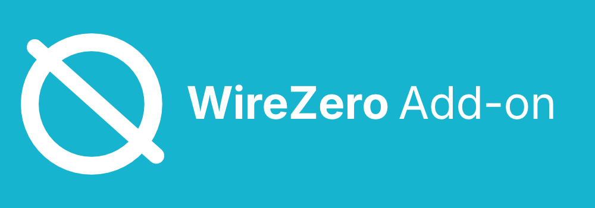

# WireZero Add-on for Firefox

WireZero is a free Firefox add-on that protects your browsing privacy by neutralizing tracking and fingerprinting techniques in real time. It blocks trackers and beacons, uncloaks DNS CNAME records, strips tracking parameters from URLs, and hardens HTTP headers and referers. It also masks browser fingerprints, prevents WebRTC IP leaks, guards against lookalike domains, and includes an optional toggle to spoof your timezone to UTC. All protections run locally in your browser with toggles and live activity counters.

## Resources

* You can download the add-on from [Firefox Add-ons](https://addons.mozilla.org/) *Please note it is still under review and this link is currently a placeholder*
* See [CONTRIBUTING.md](CONTRIBUTING.md) if you would like to report an issue or submit a patch
* Source code is licensed under the [MIT License](LICENSE)
* If you wish to report a bug / chat about WireZero, you can do that in General (found in the Discussions tab) or email me (It is preferred you only use emails to report bugs / suggest new features):
[Email Me via Gmail](https://mail.google.com/mail/?view=cm&fs=1&to=arofia01@gmail.com&su=WireZero%20%28DO%20NOT%20CHANGE%20SUBJECT%29)

DO NOT CHANGE THE SUBJECT WHEN EMAILING ME.
If the subject is changed, it will not end up in my WireZero label and I may not end up seeing the email.
